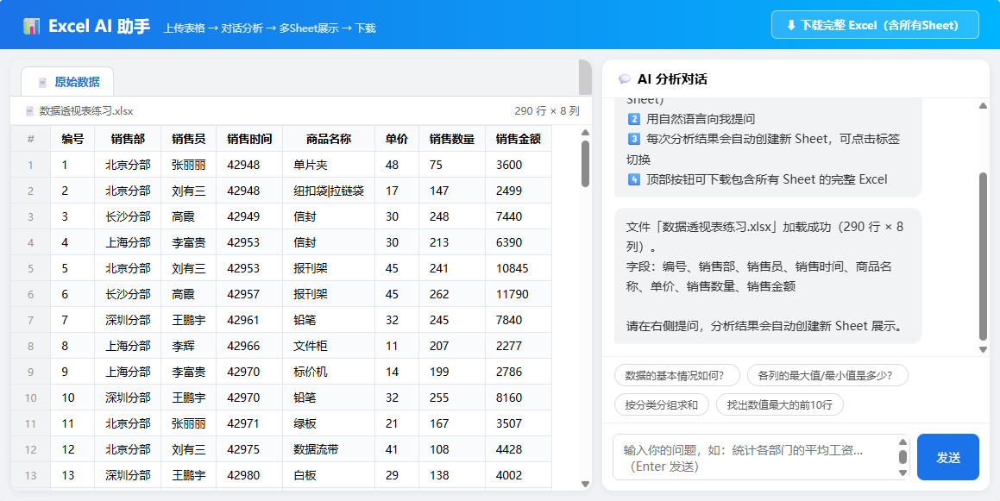
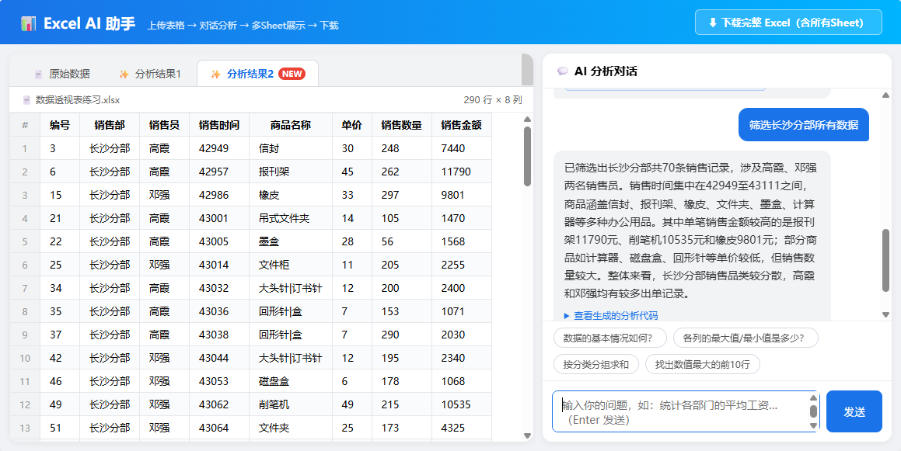
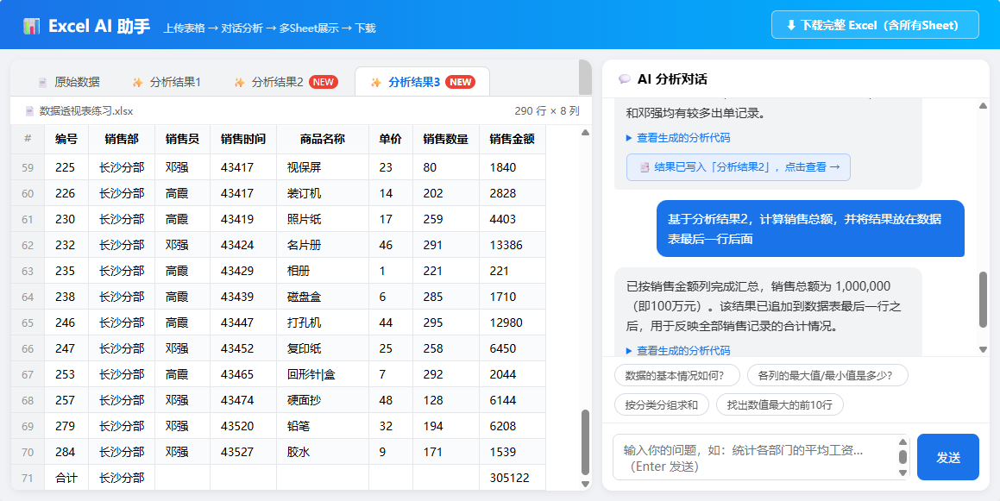
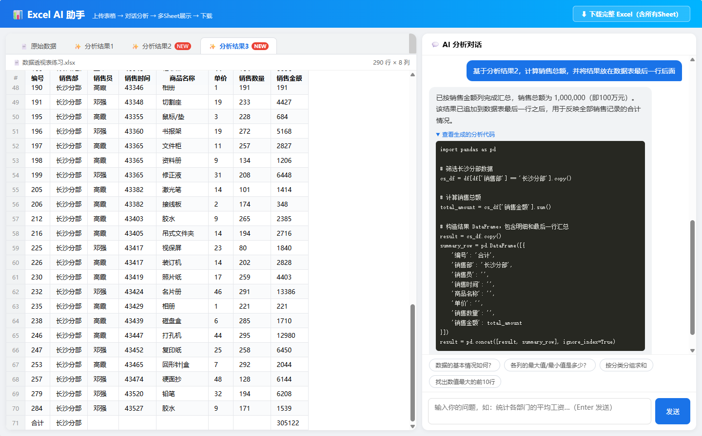

# Excel AI 助手

简要说明：一个网页端的Excel助手，允许用户上传 Excel/CSV 文件并提问，后端基于LangGraph框架构建了excel agent，agent能够根据用户上传的表格和提问进行思考和分析，生成代码，并调用代码执行工具执行，不断循环直到任务完成。该应用还支持表格的可视化，以及生成结果的可视化。

主要功能：
- 上传 xlsx / xls / csv 文件并返回表结构、预览和 session_id（/api/upload）。
- 基于上传的表格与会话历史进行问答/数据处理（/api/chat），可返回文本回答、可执行代码片段和结果表（保存为新的 Excel 并提供下载链接）。
- 下载处理结果的 Excel 文件（/api/download/{filename}）。
- 提供静态前端页面入口（static 目录）。

## 🖥️ 桌面端 + 本地模型（v0.9，当前方向）
项目正从「网页 / Excel 加载项」转向 **PC 桌面应用**，以便后续把 LLM 换成**本地微调小模型**（数据不出本机、可离线）。

- 桌面外壳：`desktop.py`（pywebview + 后台线程内嵌 FastAPI），启动：`pip install pywebview` 后 `python desktop.py`。
- LLM 提供方开关：`.env` 里 `LLM_PROVIDER=remote|local`，本地默认走 Ollama 的 OpenAI 兼容接口（`load_model.py`）。
- 微调语料自动采集：`agent.py` 把每次 `(prompt, code, ok, err)` 写入 `data/codegen_log.jsonl`。
- 完整说明（Ollama CPU 部署、模型选型、LLaMA-Factory→GGUF 微调回路）：见 **[LOCAL_MODEL.md](./LOCAL_MODEL.md)**。

## 🧩 Excel 加载项（v0.9，方案1，已暂缓）
> Excel 2021 **标准版**不支持侧加载外部加载项（无「显示在菜单」/「上传我的加载项」，需 Windows 开发者模式或企业版），故此方案暂缓，代码保留在仓库中。

除了网页版，还把智能体做成了 **Microsoft Excel 加载项（Office Add-in）**：在真实 Excel 里用自然语言分析**当前工作表**，结果写入**新工作表**并生成 **Excel 原生可编辑图表**。后端（FastAPI + LangGraph）完全复用，仅新增任务窗格前端与 `POST /api/session`（用工作表数据建会话）。

- 清单：`addin/manifest.xml`（Excel 2021 标准版，传统 v1.1 schema）
- 任务窗格：`static/addin/taskpane.html`（Office.js）
- 证书/侧加载/使用说明：见 **[addin/README.md](./addin/README.md)**

简要步骤：`bash addin/make_cert.sh` → 管理员信任证书 → `export SSL_CERTFILE/SSL_KEYFILE` 后 `python app.py`（https://localhost:8443）→ Excel「受信任的目录」侧加载 manifest。

## 运行展示
- 初始页面

- 上传excel

- 数据筛选

- 计算结果并展示

- 支持代码查看

## ⚖️ 许可声明
本项目采用自定义许可，仅限学习交流使用，禁止商业用途。详见 [LICENSE](./LICENSE.txt)。

